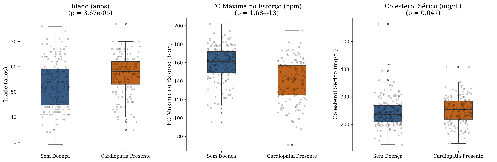

# Análise Epidemiológica Computacional e Padrões Clínicos na Doença Cardiovascular

[](https://opensource.org/licenses/MIT)
[](https://www.python.org/)

## 1. Contexto Clínico e Pergunta de Pesquisa
A cardiopatia isquêmica permanece como a principal causa de mortalidade global. Este estudo investiga a capacidade discriminatória de variáveis hemodinâmicas e metabólicas convencionais na presença de estenose coronariana clinicamente significativa ($> 50\%$ de redução do diâmetro luminal).

**Pergunta Central:** Em que medida marcadores tradicionais de consultório diferenciam pacientes cardiopatas de indivíduos sem acometimento anatômico importante?

---

## 2. Conjunto de Dados e Rigor Ético
- **Fonte Primária:** Coorte de Cleveland (UCI Machine Learning Repository).
- **Amostra:** $N = 303$ pacientes ambulatoriais submetidos à angiografia coronária.
- **Tratamento:** Exclusão de 6 observações com dados faltantes em fluoroscopia (`ca`) e cintilografia (`thal`), totalizando $N = 297$ pacientes válidos.
- **Conformidade Ética:** Dados previamente anonimizados, sem chaves de identificação individual.

---

## 3. Metodologia Estatística
- **Variáveis Contínuas:** Avaliação de normalidade via teste de Shapiro-Wilk. Dado o desvio de normalidade em subgrupos, utilizou-se o teste não-paramétrico de **Mann-Whitney U** (bilateral).
- **Variáveis Categóricas:** Tabelas de contingência e teste de independência **Qui-Quadrado ($\chi^2$) de Pearson**.
- **Nível de Significância:** $\alpha = 0{,}05$.

---

## 4. Resultados Principais

### Comparação de Biomarcadores Contínuos
Abaixo, a distribuição dos biomarcadores contínuos estratificados pelo desfecho clínico:



| Parâmetro Clínico | Sem Doença (Média ± DP) | Cardiopatia (Média ± DP) | Teste Estatístico | $p$-valor | Interpretação Clínica |
| :--- | :---: | :---: | :---: | :---: | :--- |
| **FC Máxima no Esforço (`thalach`)** | $158{,}58 \pm 19{,}04$ bpm | $139{,}11 \pm 22{,}71$ bpm | Mann-Whitney U | $1{,}68 \times 10^{-13}$ | Forte marcador: incompetência cronotrópica ou interrupção precoce por dor. |
| **Idade (`age`)** | $52{,}64 \pm 9{,}55$ anos | $56{,}76 \pm 7{,}90$ anos | Mann-Whitney U | $3{,}67 \times 10^{-5}$ | Risco acumulado compatível com aterogênese progressiva. |
| **Colesterol Sérico (`chol`)** | $243{,}49 \pm 53{,}76$ mg/dL | $251{,}85 \pm 49{,}68$ mg/dL | Mann-Whitney U | $0{,}047$ | Significante, mas com sobreposição expressiva entre os grupos. |

### Associação Demográfica (Sexo Biológico)
- **Feminino:** Prevalência de doença de $26{,}0\%$ ($25/96$).
- **Masculino:** Prevalência de doença de $55{,}7\%$ ($112/201$).
- $\chi^2 = 21{,}85$, Graus de Liberdade = $1$, $p = 2{,}95 \times 10^{-6}$.
- **Nota Crítica:** Sugere forte viés de encaminhamento hospitalar e potenciais diferenças na sintomatologia feminina.

---

## 5. Limitações Científicas
1. **Amostra Monocêntrica:** Dados limitados ao padrão hospitalar dos anos 1980 na Cleveland Clinic.
2. **Desfecho Dicotomizado:** Reduz a gradação da complexidade estenótica (0 a 4 ramos anatômicos acometidos).
3. **Ausência de Marcadores Inflamatórios:** Ausência de proteína C-reativa ultrassensível (PCR-us) ou painel lipídico detalhado (apoB, LDL denso).

---

## 6. Como Reproduzir

```bash
# Clonar o repositório
git clone [https://github.com/cristianool/cardio-epidemiology-eda.git](https://github.com/cristianool/cardio-epidemiology-eda.git)
cd cardio-epidemiology-eda

# Configurar ambiente virtual
python3 -m venv .venv
source .venv/bin/activate

# Instalar dependências
pip install -r requirements.txt

# Executar o caderno de experimentos
jupyter notebook notebooks/01_eda_epidemiologia_cardiovascular.ipynb